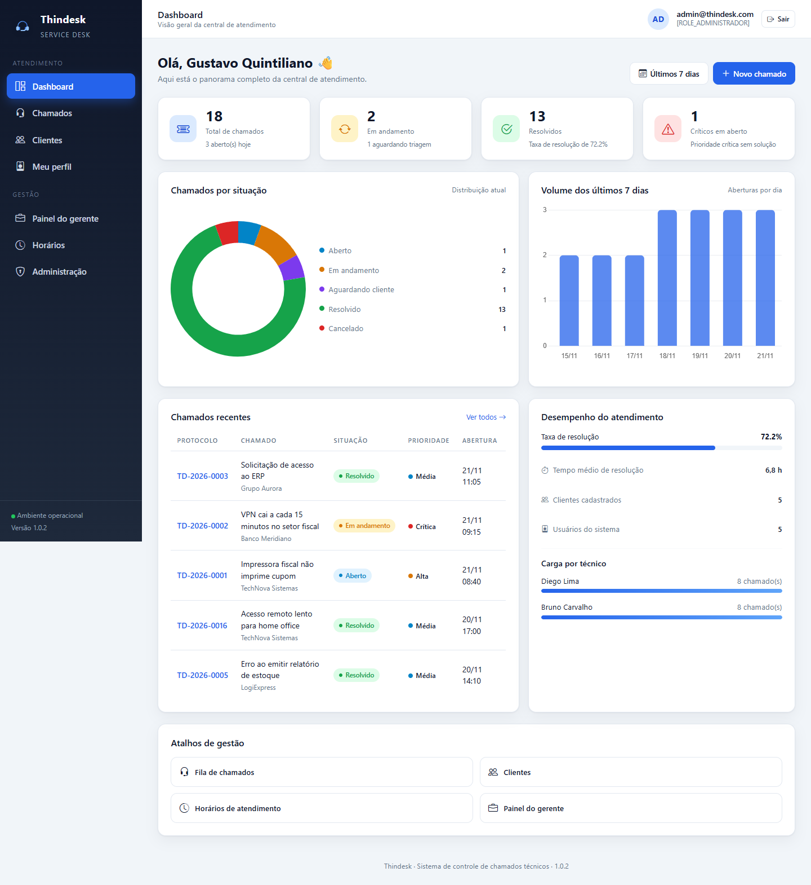

# Thindesk

Sistema corporativo de **controle de chamados técnicos** desenvolvido com **Java 21**, **Spring Boot 3.4**, **MongoDB**, **Thymeleaf** e **Spring Security**.

A aplicação centraliza a abertura, a triagem e a resolução de solicitações de suporte, com perfis de acesso para **usuário**, **gerente** e **administrador**, além de um dashboard com indicadores de atendimento.


---

## Sobre o projeto

O Thindesk foi construído como um sistema de service desk corporativo. Cada chamado possui protocolo próprio, prioridade, tipo, cliente, setor, solicitante, técnico responsável e histórico de comentários.

O fluxo de atendimento é:

```text
Abertura -> Triagem -> Em andamento -> Aguardando cliente -> Resolvido
                              |
                              +-> Cancelado
```

### Funcionalidades

- Login, logout e cadastro de usuários com validação de dados;
- Senhas protegidas com **BCrypt** (fator 12);
- Controle de acesso por perfil (`USUARIO`, `GERENTE`, `ADMINISTRADOR`);
- Dashboard com indicadores, gráficos e chamados recentes;
- Abertura, edição, acompanhamento, comentário, cancelamento e resolução de chamados;
- Atribuição de técnico responsável;
- Cadastro e manutenção de clientes;
- Cadastro de horários de atendimento por setor;
- Painel do gerente com fila de atendimento e carga por técnico;
- Painel administrativo com gestão de usuários, perfis e ativação de contas;
- API REST protegida para chamados e clientes;
- Persistência de dados e de sessões HTTP no MongoDB;
- Testes unitários com JUnit 5 e Mockito.

---

## Stack

| Camada | Tecnologia |
| --- | --- |
| Linguagem | Java 21 |
| Framework | Spring Boot 3.4.0 |
| Web | Spring MVC + Thymeleaf + Thymeleaf Layout Dialect |
| Segurança | Spring Security 6 + BCrypt |
| Persistência | Spring Data MongoDB |
| Sessões | Spring Session Data MongoDB |
| Validação | Jakarta Bean Validation |
| Front-end | HTML5, CSS3, JavaScript, Bootstrap 5 e Chart.js |
| Testes | JUnit 5, Mockito e Spring Test |
| Build | Maven (wrapper incluído) |
| Deploy | Render (Docker) + MongoDB Atlas |

---

## Arquitetura

A aplicação segue a arquitetura em camadas utilizada nos projetos da disciplina:

```text
Navegador / Cliente HTTP
          |
          v
  Controllers (MVC e REST)
          |
          v
   Services (regras de negócio)
          |
          v
 Repositories (Spring Data MongoDB)
          |
          v
        MongoDB
```

As páginas são renderizadas no servidor com Thymeleaf:

```text
Controllers -> Model -> Templates Thymeleaf -> HTML + CSS + JavaScript
```

### Estrutura do projeto

```text
thindesk/
├── src/
│   ├── main/
│   │   ├── java/com/pfc/thindesk/
│   │   │   ├── config/          # Segurança, sessão, inicialização e dados de demonstração
│   │   │   ├── controller/      # Controllers MVC e da API REST
│   │   │   ├── dto/             # Objetos de entrada e saída
│   │   │   ├── entity/          # Chamado, Cliente, Horário e enums
│   │   │   ├── excecao/         # Exceções e tratador global
│   │   │   ├── model/           # Usuário e Perfil
│   │   │   ├── repositorio/     # Interfaces Spring Data MongoDB
│   │   │   ├── servico/         # Regras de negócio
│   │   │   └── ThindeskApplication.java
│   │   └── resources/
│   │       ├── application.properties
│   │       ├── static/          # CSS, JavaScript e imagens
│   │       └── templates/       # Páginas Thymeleaf
│   └── test/java/com/pfc/thindesk/
│       ├── controller/
│       └── servico/
├── docs/                        # Print do dashboard
├── Dockerfile
├── render.yaml
├── pom.xml
├── mvnw
└── mvnw.cmd
```

---

## Versionamento semântico (SemVer)

O projeto adota o **Versionamento Semântico 2.0.0**, conforme a especificação oficial disponível em
[semver.org/lang/pt-BR](https://semver.org/lang/pt-BR/).

### Versão atual

```text
1.0.2
```

O formato utilizado é:

```text
MAJOR.MINOR.PATCH[-pre-release][+build]
```

| Parte | Significado | Quando é incrementada |
| --- | --- | --- |
| `MAJOR` | Versão principal | Mudanças incompatíveis na API ou na forma de usar o sistema |
| `MINOR` | Versão secundária | Novas funcionalidades compatíveis com a versão anterior |
| `PATCH` | Correção | Correções de bugs compatíveis, sem novas funcionalidades |
| `-pre-release` | Pré-lançamento | Versões em homologação, como `1.1.0-beta.1` |
| `+build` | Metadados de build | Informações internas de compilação, como `1.0.0+20261119` |

### Histórico de versões

| Versão | Tag | Conteúdo |
| --- | --- | --- |
| `0.1.0` | `v0.1.0` | Estrutura base, tema visual e configuração do projeto |
| `0.2.0` | `v0.2.0` | Autenticação, cadastro e gestão de usuários |
| `0.3.0` | `v0.3.0` | Módulo de chamados e fluxo de atendimento |
| `0.4.0` | `v0.4.0` | Clientes e horários de atendimento |
| `0.5.0` | `v0.5.0` | Dashboard, indicadores e painéis de gestão |
| `0.6.0` | `v0.6.0` | API REST, tratamento de erros e testes automatizados |
| `1.0.0-beta.1` | `v1.0.0-beta.1` | Versão de homologação da release 1.0.0 |
| `1.0.0` | `v1.0.0` | Primeira versão estável, publicada em produção |
| `1.0.1` | `v1.0.1` | Correção do build da imagem Docker e publicação do deploy |
| `1.0.2` | `v1.0.2` | Ajuste dos dados de demonstração e do print do dashboard |

### Regras adotadas

- Correção de bug compatível: `1.0.0` -> `1.0.1`;
- Nova funcionalidade compatível: `1.0.0` -> `1.1.0`;
- Mudança incompatível: `1.0.0` -> `2.0.0`;
- Versão em testes: `1.1.0-beta.1`, promovida para `1.1.0` após validação;
- A versão estável nunca recebe novos recursos sem incremento de `MINOR` ou `MAJOR`.

A versão da aplicação é exibida no rodapé e no menu lateral, e é controlada pela propriedade `app.versao`
em `src/main/resources/application.properties` e pela versão do `pom.xml`.

---

## Dashboard

Print da tela de dashboard da aplicação em execução:



O dashboard apresenta:

- Total de chamados, chamados em andamento, resolvidos e críticos em aberto;
- Gráfico de distribuição por situação;
- Gráfico de volume de aberturas nos últimos 7 dias;
- Lista dos chamados mais recentes;
- Taxa de resolução, tempo médio de atendimento e carga por técnico.

---

## Deploy

| Ambiente | Endereço |
| --- | --- |
| Aplicação publicada | `https://thindesk-yeat.onrender.com` |
| Repositório | https://github.com/Quingu/Thindesk |

> O deploy é feito no **Render** a partir do `Dockerfile` deste repositório, com os dados persistidos no **MongoDB Atlas**.

### Credenciais de demonstração

Qualquer pessoa pode acessar a aplicação publicada com uma das contas abaixo:

| Perfil | E-mail | Senha |
| --- | --- | --- |
| Administrador | `admin@thindesk.com` | `Thindesk@2026` |
| Gerente | `gerente@thindesk.com` | `Thindesk@2026` |
| Técnico (gerente) | `tecnico@thindesk.com` | `Thindesk@2026` |
| Usuário | `usuario@thindesk.com` | `Thindesk@2026` |

Também é possível criar uma conta nova pela tela de cadastro. Contas criadas recebem o perfil `USUARIO`.

---

## Como executar localmente

### Pré-requisitos

- Java 21;
- MongoDB local **ou** uma URI do MongoDB Atlas;
- Git.

### Passos

```bash
git clone https://github.com/Quingu/Thindesk.git
cd Thindesk

# Linux/macOS
export MONGODB_URI="mongodb://localhost:27017/thindesk"
./mvnw spring-boot:run

# Windows (PowerShell)
$env:MONGODB_URI="mongodb://localhost:27017/thindesk"
.\mvnw.cmd spring-boot:run
```

Acesse: `http://localhost:8080`

Na primeira execução, a aplicação cria as coleções e insere os dados de demonstração
(usuários, clientes, chamados e horários) quando a base está vazia. Esse comportamento pode ser
desativado com `APP_SEMENTE_DADOS=false`.

### Variáveis de ambiente

| Variável | Padrão | Descrição |
| --- | --- | --- |
| `MONGODB_URI` | `mongodb://localhost:27017/thindesk` | String de conexão do MongoDB |
| `MONGODB_DATABASE` | `thindesk` | Nome do banco de dados |
| `PORT` | `8080` | Porta HTTP da aplicação |
| `APP_TEMA` | `padrao` | Tema visual (`padrao` ou `escuro`) |
| `APP_VERSAO` | `1.0.2` | Versão exibida na interface |
| `APP_SEMENTE_DADOS` | `true` | Insere dados de demonstração em base vazia |

### Build

```bash
./mvnw clean package
java -jar target/thindesk-1.0.2.jar
```

### Docker

```bash
docker build -t thindesk .
docker run -p 8080:8080 -e MONGODB_URI="mongodb+srv://..." thindesk
```

---

## Rotas principais

| Método | Rota | Descrição | Acesso |
| --- | --- | --- | --- |
| GET | `/` | Página inicial | Público |
| GET | `/login` | Tela de login | Público |
| GET/POST | `/cadastro` | Cadastro de usuário | Público |
| GET | `/dashboard` | Dashboard | Autenticado |
| GET | `/perfil` | Perfil do usuário | Autenticado |
| GET | `/chamados` | Lista de chamados | Autenticado |
| GET/POST | `/chamados/novo` | Abertura de chamado | Autenticado |
| GET | `/chamados/{id}` | Detalhe do chamado | Solicitante, gerente ou admin |
| POST | `/chamados/{id}/comentario` | Comentário no chamado | Solicitante, gerente ou admin |
| POST | `/chamados/{id}/resolver` | Resolução do chamado | Gerente ou admin |
| GET | `/clientes` | Lista de clientes | Autenticado |
| GET | `/gerente/painel` | Painel do gerente | Gerente ou admin |
| GET | `/ajustes-horarios` | Horários de atendimento | Gerente ou admin |
| GET | `/administrador/painel` | Painel administrativo | Admin |

---

## API REST

A API exige autenticação e perfil **ADMINISTRADOR**.

| Método | Endpoint | Funcionalidade |
| --- | --- | --- |
| GET | `/api/chamados` | Lista chamados (filtros `busca`, `situacao`, `prioridade`) |
| GET | `/api/chamados/{id}` | Consulta um chamado |
| POST | `/api/chamados` | Abre um chamado |
| PUT | `/api/chamados/{id}` | Atualiza um chamado |
| PUT | `/api/chamados/{id}/resolver` | Registra a solução |
| DELETE | `/api/chamados/{id}` | Exclui um chamado |
| GET | `/api/clientes` | Lista clientes |
| POST | `/api/clientes` | Cria cliente |
| PUT | `/api/clientes/{id}` | Atualiza cliente |
| DELETE | `/api/clientes/{id}` | Exclui cliente |

Exemplo de abertura de chamado:

```bash
curl -u admin@thindesk.com:Thindesk@2026 \
  -H "Content-Type: application/json" \
  -d '{"titulo":"Impressora sem conexão","descricao":"A impressora do financeiro parou de responder.","prioridade":"ALTA","tipo":"IMPRESSORA"}' \
  http://localhost:8080/api/chamados
```

Erros da API retornam JSON padronizado:

```json
{
  "status": 404,
  "mensagem": "Chamado não encontrado.",
  "dataHora": "2026-11-19T10:15:00"
}
```

---

## Gitflow

O desenvolvimento seguiu o modelo **Gitflow**:

```text
main
 └── develop
      ├── feature/estrutura-base
      ├── feature/autenticacao
      ├── feature/chamados
      ├── feature/clientes-e-horarios
      ├── feature/painel-dashboard
      ├── feature/api-e-testes
      └── release/1.0.0
main <── merge release/1.0.0 (tag v1.0.0)
develop <── merge release/1.0.0

main
 └── hotfix/1.0.1
main <── merge hotfix/1.0.1 (tag v1.0.1)
develop <── merge hotfix/1.0.1

main
 └── hotfix/1.0.2
main <── merge hotfix/1.0.2 (tag v1.0.2)
develop <── merge hotfix/1.0.2
```

Regras aplicadas:

- `main` contém apenas versões estáveis e tagueadas;
- `develop` integra as funcionalidades concluídas;
- `feature/*` nasce de `develop` e retorna para `develop` via merge;
- `release/1.0.0` estabiliza a versão, recebe documentação e deploy;
- `hotfix/1.0.1` corrige a falha de build em produção e retorna para `main` e `develop`;
- `hotfix/1.0.2` ajusta os dados de demonstração e o print do dashboard;
- cada branch foi criada com intervalo de **10 a 15 minutos** da anterior, mantendo o histórico de evolução do projeto.

Para visualizar o histórico:

```bash
git log --graph --oneline --all --decorate
git tag -n
```

---

## Testes

```bash
./mvnw test
```

Cobertura atual:

- `ServicoChamadoTest` — abertura, resolução, regras de negócio e recurso inexistente;
- `ServicoUsuarioTest` — cadastro, criptografia de senha, senhas divergentes e e-mail duplicado;
- `ControladorApiChamadoTest` — listagem em JSON e tratamento de erro 404.

---

## Segurança

- Autenticação por formulário com Spring Security;
- Autorização por perfil em rotas e métodos (`@PreAuthorize`);
- Senhas armazenadas com BCrypt (fator 12);
- Proteção CSRF nas telas;
- Sessões persistidas no MongoDB com expiração de 30 minutos;
- Tratamento de acesso negado, 404 e 500.

---

## Autor

**Gustavo Quintiliano**  
Projeto acadêmico — Sistema corporativo de controle de chamados técnicos.
